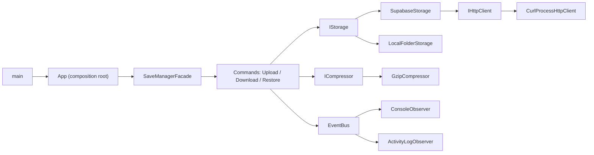

# Valheim Save Manager (vsm)

Command line tool (C++17) that shares Valheim world saves between players:
it compresses the world files (`.db`, `.fwl`) with gzip, uploads them to a
cloud storage (Supabase Storage) and downloads them again. Every upload and
download is written into a shared activity log, so everybody can see who
played last. Local files are always backed up before a download overwrites
them, and the backup can be restored.

It is a C++ port of the earlier Python/Tkinter "Valheim Save Manager v2",
written for the *Production Software Development* course: source code,
design patterns, CMake, Git and unit tests.

## Usage

```
vsm upload   [options]    compress the local world and upload it
vsm download [options]    download the world (local files are backed up first)
vsm status   [options]    show who touched the world last
vsm restore  [options]    restore the newest local backup
```

Options: `--config <file>`, `--save-dir <dir>`, `--local-storage <dir>`,
`--user <name>`, `--world <name>`.

Without `--save-dir` the Windows default
`%USERPROFILE%\AppData\LocalLow\IronGate\Valheim\worlds_local` is used.
With `--local-storage <dir>` a plain folder replaces Supabase (offline use,
OneDrive/Syncthing folders, demos).

### Configuration

Copy `config.example.json` to `config.json` (it is git-ignored) and fill it in.
The Supabase key can instead be provided through the `VSM_SUPABASE_KEY`
environment variable, so that no secret has to be stored in a file.

## Build

Requirements: a C++17 compiler, CMake >= 3.16, git, curl (curl.exe is part of
Windows 10+). All libraries (GoogleTest, zlib, nlohmann/json) are downloaded
automatically by CMake (`FetchContent`).

```
cmake -S . -B build -DCMAKE_BUILD_TYPE=Release
cmake --build build -j
ctest --test-dir build --output-on-failure
cmake --build build --target docs      # needs Doxygen
```

`./build.sh [Debug|Release]` does the configure, build and test steps.

## Design



### Design patterns used

| Pattern | Where | Problem it solves |
|---|---|---|
| Singleton | `Config` | one configuration for the whole program |
| Strategy | `IStorage` (`SupabaseStorage`, `LocalFolderStorage`), `ICompressor`, `IPathProvider` | the algorithm/backend can be swapped without changing the logic |
| Factory | `makePathProvider`, `makeStorage` (in `App.cpp`) | the caller does not choose the concrete class |
| Observer | `EventBus`, `ConsoleObserver`, `ActivityLogObserver` | commands announce what happened without knowing who listens |
| Command | `UploadCommand`, `DownloadCommand`, `RestoreLatestBackupCommand` | actions are objects, so they can be undone (`undo()`) |
| Facade | `SaveManagerFacade` | the CLI sees five simple methods instead of the whole subsystem |
| Dependency Injection | `CommandContext`, `SupabaseStorage(IHttpClient&, ...)` | everything is injected, so tests use fakes and need no network |

Design principles: programming to interfaces, favour composition over
inheritance, Open-Closed (a new storage backend is a new class), Dependency
Inversion (business logic depends on abstractions).

## Tests

GoogleTest, registered with CTest (`gtest_discover_tests`). Storage and HTTP
are replaced by a temporary folder and a fake HTTP client, so the whole test
suite runs offline in a fraction of a second.

## Source layout

```
include/vsm/   public headers (Doxygen documented)
src/           implementation and main.cpp
tests/         unit tests
```
